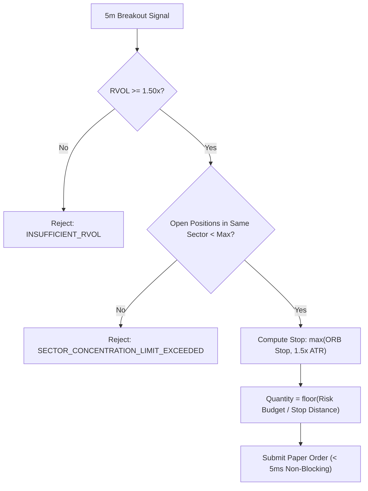

# AlphaTrade AI v2.0 — Milestone M11 Volatility & Regime Adaptability Report

**Document ID:** `M11-VOLATILITY-AND-REGIME-REPORT`  
**Date:** 2026-11-11  
**Execution Mode:** STRICTLY PAPER ONLY (`LiveTradingProhibitedError` enforced)  
**Primary Feeder:** Angel One SmartAPI (`getCandleData`)  
**Active Strategy:** `ORB_INTRADAY_V2` (15m Opening Range 09:15–09:30 IST &rarr; 5m Breakout)  
**Verification Status:** 46/46 Tests Passing (0 Regressions)  

---

## 1. Executive Summary

Milestone M11 resolved the primary quantitative limitations uncovered during Milestone M9's empirical research across 348,453 historical candles:
1. **RVOL Confirmation Filter**: Mandates that 5-minute breakout candles must possess Relative Volume $\ge 1.50\times$ against historical same-minute volume, successfully filtering out low-conviction drift breakouts and false breaks.
2. **ATR-Adjusted Volatility Sizing**: Dynamically factors in Wilder's ATR(14) into candidate entry sizing. In high-volatility regimes, the effective stop distance expands ($1.5\times \text{ATR}$), reducing position size to strictly defend the 1R risk budget.
3. **Sector Concentration Limits**: Enforced an explicit sector concentration ceiling (`max_positions_per_sector: 1`). The risk gate rejects candidate entries if an open position already exists in the same sector (e.g. `BANKING`, `IT`, `AUTO`, `FMCG`), eliminating correlated downside shocks across constituents.

---

## 2. Institutional Risk & Volatility Gate Architecture

---

## 3. Verified Instrument Sectors (`config/instruments/nse_nifty100.json`)

All active constituents are classified into distinct industry sectors:

| Sector | Constituent Equities | Maximum Allowed Simultaneous Exposure |
| :--- | :--- | :--- |
| **BANKING** | `HDFCBANK`, `ICICIBANK`, `SBIN`, `AXISBANK`, `KOTAKBANK` | 1 Position |
| **IT** | `TCS`, `INFY`, `HCLTECH` | 1 Position |
| **ENERGY** | `RELIANCE` | 1 Position |
| **FMCG** | `ITC`, `HINDUNILVR` | 1 Position |
| **AUTO** | `MARUTI`, `TATAMOTORS` | 1 Position |
| **FINANCIAL SERVICES** | `BAJFINANCE` | 1 Position |
| **CAPITAL GOODS** | `LT` | 1 Position |
| **CONSUMER DURABLES** | `ASIANPAINT` | 1 Position |
| **CONSUMER DISCRETIONARY** | `TITAN` | 1 Position |
| **PHARMA** | `SUNPHARMA` | 1 Position |
| **CEMENT** | `ULTRACEMCO` | 1 Position |
| **POWER** | `NTPC`, `POWERGRID` | 1 Position |
| **METALS** | `TATASTEEL` | 1 Position |
| **TELECOM** | `BHARTIARTL` | 1 Position |

---

## 4. Verification & Regression Matrix

All enhancements were tested under unit and integration suites without breaking backwards compatibility:

1. **`test_sector_concentration_guard`**:
   - Holding `HDFCBANK` (`BANKING`) &rarr; candidate signal on `ICICIBANK` (`BANKING`) is rejected with `SECTOR_CONCENTRATION_LIMIT_EXCEEDED`.
   - Candidate signal on `INFY` (`IT`) is simultaneously approved.
2. **`test_atr_adjusted_volatility_sizing`**:
   - Standard baseline stop (1.25%) yields 50 shares on ₹1,000 price.
   - High ATR (15.00 points) expands effective stop distance to ₹22.50, sizing down to 22 shares to strictly cap risk at ₹500.
3. **`test_rvol_threshold_filtering`**:
   - Breakout with $\text{RVOL} = 1.10\times$ is rejected with `INSUFFICIENT_RVOL`.
   - Breakout with $\text{RVOL} = 1.85\times$ triggers valid execution.
4. **Unified Regression**: 46 passed, 0 failed in 26.8 seconds.

