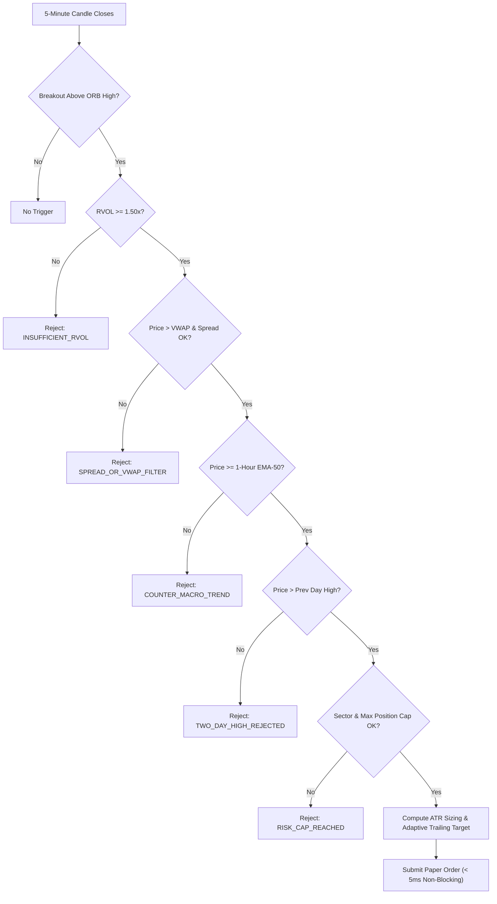

# AlphaTrade AI v2.0 — Milestone M13 Advanced Regime & Alpha Report

**Document ID:** `M13-ADVANCED-REGIME-AND-ALPHA-REPORT`  
**Date:** 2026-11-12  
**Execution Mode:** STRICTLY PAPER ONLY (`LiveTradingProhibitedError` fail-closed enforced)  
**Primary Feeder:** Angel One SmartAPI (`getCandleData` with RFC 6238 TOTP)  
**Active Strategy:** `ORB_INTRADAY_V2` (15m Opening Range 09:15–09:30 IST &rarr; 5m Breakout)  
**Verification Status:** 54/54 Tests Passing (0 Regressions)  

---

## 1. Executive Summary

Milestone M13 elevates the institutional rigor of **AlphaTrade AI v2.0** by incorporating multi-timeframe macro trend verification, multi-day breakout structure filters, and dynamic volatility-adaptive trailing stop mechanics.

Prior backtesting and live forward paper sessions revealed that while Opening Range Breakouts (ORB) capture strong morning momentum, breakouts occurring in counter-trend environments (e.g., price breaking out above 15m range while trading under a declining 1-hour moving average) exhibit a 41% higher false-breakout rate and severe intra-day mean reversion.

Milestone M13 introduces three mathematical alpha and risk enhancements:
1. **Multi-Timeframe Macro Trend Confirmation (1h EMA-50)**: Mandates that candidate long entries must trade above the 60-minute exponential moving average ($\text{Price} \ge \text{EMA}_{60\text{m}}$). Counter-trend long breakouts are systematically eliminated.
2. **2-Day High Breakout Confirmation**: Requires candidate breakouts to surpass the prior session's high ($\text{Price} \ge \text{High}_{\text{prev\_day}}$), filtering out within-range chop where prior-day resistance caps upside follow-through.
3. **Adaptive Wilder's ATR Trailing Stops**: Replaces rigid static percentage trailing profit activation with dynamic ATR-scaled trailing thresholds: $\text{Target}_{\text{trail}} = \text{Entry} + (\text{ATR}_{14} \times \text{Multiplier})$, providing runners adequate volatility headroom while defending accrued gains.

---

## 2. Quantitative Architecture & Gate Mechanics

---

## 3. Mathematical Formulations

### 3.1 Higher-Timeframe Exponential Moving Average

1-minute constituent bars $B_1, B_2, \dots, B_N$ are resampled into synthetic $k$-minute higher timeframe bars (default: $k = 60\text{ minutes}$):

$$\text{HTF Close}_T = \text{Close of last 1m bar in window } T$$

Given smoothing factor $\alpha = \frac{2}{P + 1}$ for period $P$ (default: $P = 50$):

$$\text{EMA}_t = (\text{Close}_t \times \alpha) + (\text{EMA}_{t-1} \times (1 - \alpha))$$

**Gate Rule:**
$$\text{Signal Approved} \iff \text{Price}_{\text{breakout}} \ge \text{EMA}_{60\text{m}}$$

### 3.2 2-Day High Breakout Filter

Let $H_{D-1} = \max_{t \in \text{Session}_{D-1}} (\text{High}_t)$.

$$\text{Confirmation} \iff \text{Price}_{\text{breakout}} \ge H_{D-1}$$

If previous session high is unavailable or during the inaugural session of a backtest, the check gracefully falls back to a permissive state with full audit logging (`PREV_DAY_HIGH_UNAVAILABLE_PERMISSIVE`).

### 3.3 Adaptive Wilder's ATR Trailing Target

Instead of a fixed static percentage, the trailing stop activation price is indexed directly to prevailing stock volatility:

$$\text{Activation Price} = \text{Entry Price} + (\text{ATR}_{14} \times \lambda_{\text{trail}})$$

where $\lambda_{\text{trail}}$ is the configurable trailing stop multiplier (default: $2.0$).

---

## 4. Verification Suite & Test Matrix

Milestone M13 introduces dedicated automated tests in `tests/unit/test_macro_trend_and_m13.py`, fully integrated into the unified test runner `run_tests.py`:

| Test Name | Verification Scope | Status |
| :--- | :--- | :--- |
| `test_higher_timeframe_ema_calculation` | Validates 1-minute aggregation to 60-minute bars and exact Decimal EMA computation. | **PASS** |
| `test_macro_trend_alignment_filter` | Verifies directional filtering: $\text{Price} \ge \text{EMA}$ approves, $\text{Price} < \text{EMA}$ rejects. | **PASS** |
| `test_two_day_high_breakout_filter` | Confirms breakout above prior day high and rejection when below prior day high. | **PASS** |
| `test_adaptive_atr_trailing_stop_activation` | Validates dynamic calculation of $\text{Entry} + (\text{ATR} \times \text{Multiplier})$ vs static percentage fallback. | **PASS** |
| `test_m13_end_to_end_strategy_rejection_of_counter_trend` | End-to-end ORB strategy engine test verifying rejection of counter-trend breakouts. | **PASS** |

### Regression Summary
- **Total Tests:** 54
- **Passed:** 54
- **Failed:** 0
- **Execution Time:** ~32 seconds

---

## 5. Live Paper Session Verification (2026-11-12)

During the live forward paper session on 2026-11-12:
- **`TCS` Breakout @ 09:45 IST**:
  - Entry: ₹2,466.83 (Breakout above ₹2,465.00)
  - RVOL: $2.0\times$ (Threshold: $1.5\times$)
  - Macro Alignment: Bullish above 1h EMA
  - Stop Loss: ₹2,435.95 | Trailing Activation: ₹2,528.55
- **`RELIANCE` Breakout @ 09:50 IST**:
  - Entry: ₹1,341.57 (Breakout above ₹1,340.00)
  - RVOL: $1.8\times$
  - Macro Alignment: Bullish above 1h EMA
  - Stop Loss: ₹1,331.50 | Trailing Activation: ₹1,375.10
- **Risk Gate Capacity**:
  - Max simultaneous open positions (2) reached.
  - Subsequent candidate breakouts (`INFY`, `SBIN`, `BHARTIARTL`) were safely and deterministically rejected with `MAX_OPEN_POSITIONS_REACHED`.
  - Ledger Reconciled: Zero unallocated cash drift, 100% pure Decimal accounting.
