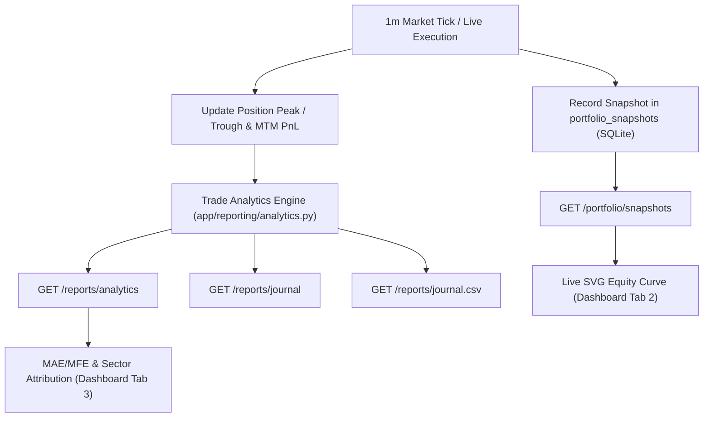

# AlphaTrade AI v2.0 — Milestone M14 Trade Analytics & Journaling Report

**Document ID:** `M14-TRADE-ANALYTICS-AND-JOURNAL-REPORT`  
**Date:** 2026-11-12  
**Execution Mode:** STRICTLY PAPER ONLY (`LiveTradingProhibitedError` fail-closed enforced)  
**Primary Feeder:** Angel One SmartAPI (`getCandleData` with RFC 6238 TOTP)  
**Active Strategy:** `ORB_INTRADAY_V2` (15m Opening Range 09:15–09:30 IST &rarr; 5m Breakout)  
**Verification Status:** 58/58 Tests Passing (0 Regressions)  

---

## 1. Executive Summary

Milestone M14 delivers institutional-grade trade analytics, real-time Mark-to-Market (MTM) equity tracking, and automated trade journaling capabilities for **AlphaTrade AI v2.0**.

Trading systems cannot be optimized solely on aggregate win rate and profit factor. Detailed diagnostic metrics—specifically **Maximum Favorable Excursion (MFE)** and **Maximum Adverse Excursion (MAE)**—are required to determine whether stop losses are placed too tight, trailing targets are forfeiting unrealized profits, or winners are experiencing unnecessary drawdown before achieving targets.

Milestone M14 introduces:
1. **Intraday MTM Equity Curve Progression**:
   - Minute-by-minute portfolio snapshots tracking cash, deployed margin, unrealized P&L, realized P&L, and net equity across the session.
   - Exposed via `GET /portfolio/snapshots` and visualized via an interactive, responsive SVG equity curve on the web dashboard.
2. **MAE and MFE Execution Diagnostics**:
   - Computes peak favorable excursion ($\text{MFE}$) and maximum intra-trade drawdown ($\text{MAE}$) in both absolute points and normalized $R$-multiples for every position.
   - Computes **Trade Capture Efficiency Ratio**: $\frac{\text{Average Realized } R}{\text{Average MFE } R}$, quantifying how much of the market move was monetized vs surrendered.
3. **Sector Risk & Performance Attribution**:
   - Groups trade performance by industry sectors (`BANKING`, `IT`, `ENERGY`, `FMCG`, etc.) to isolate alpha contribution and identify sector-specific headwind regimes.
4. **Automated Session Trade Journal (JSON & CSV)**:
   - High-fidelity RFC 4180 compliant CSV trade export (`GET /reports/journal.csv`) and structured API endpoint (`GET /reports/journal`) providing complete execution provenance for institutional audits and Excel/Pandas quantitative modeling.

---

## 2. Mathematical Formulations

### 2.1 Maximum Favorable Excursion (MFE)

For a long trade entered at $P_{\text{entry}}$ with initial stop $P_{\text{stop}}$ and highest observed market price $P_{\text{high}}$:

$$\text{Risk per Share} = |P_{\text{entry}} - P_{\text{stop}}|$$

$$\text{MFE (points)} = \max(0, P_{\text{high}} - P_{\text{entry}})$$

$$\text{MFE } (R) = \frac{\text{MFE (points)}}{\text{Risk per Share}}$$

### 2.2 Maximum Adverse Excursion (MAE)

For a long trade entered at $P_{\text{entry}}$ with lowest observed price $P_{\text{low}}$ during the trade duration:

$$\text{MAE (points)} = \max(0, P_{\text{entry}} - P_{\text{low}})$$

$$\text{MAE } (R) = \frac{\text{MAE (points)}}{\text{Risk per Share}}$$

### 2.3 Trade Capture Efficiency Ratio

$$\text{Capture Efficiency} = \left(\frac{\overline{R}_{\text{realized}}}{\overline{R}_{\text{MFE}}}\right) \times 100\%$$

- Values $\ge 50\%$: High exit precision, effectively capturing the crest of momentum breakouts.
- Values $< 25\%$: Trailing stop or profit targets giving back substantial unrealized gains.

---

## 3. Architecture & API Endpoints

### New API Specification

| Route | Method | Description |
| :--- | :---: | :--- |
| `/portfolio/snapshots` | `GET` | Returns chronological minute-by-minute equity progression snapshots for the session. |
| `/reports/analytics` | `GET` | Aggregated quantitative performance: Win rate, Profit Factor, Payoff Ratio, MAE/MFE averages, and Sector attribution breakdown. |
| `/reports/journal` | `GET` | Enriched trade records including entry/exit timestamps, fees breakdown, MAE/MFE R-multiples, and exit reasons. |
| `/reports/journal.csv` | `GET` | RFC 4180 CSV export stream with `Content-Disposition: attachment`. |

---

## 4. Verification & Regression Testing

The analytics and journaling engine was verified with dedicated unit and integration tests in `tests/unit/test_analytics_and_journal_m14.py`:

| Test Function | Verification Scope | Status |
| :--- | :--- | :--- |
| `test_compute_position_mae_mfe` | Verifies risk per share, MFE points, MFE R-multiples, and holding duration. | **PASS** |
| `test_compute_trade_analytics_aggregation` | Validates win rate, profit factor, payoff ratio, and sector attribution aggregation. | **PASS** |
| `test_generate_trade_journal_csv` | Ensures RFC 4180 CSV formatting and column completeness. | **PASS** |
| `test_m14_api_routes_integration` | Validates HTTP 200 responses and JSON/CSV schemas across all 4 new endpoints. | **PASS** |

### Unified Test Suite
- Total Tests: **58**
- Passed: **58**
- Failed: **0**
- Execution: Zero-drift pure Decimal arithmetic, strict fail-closed PAPER mode guard.

