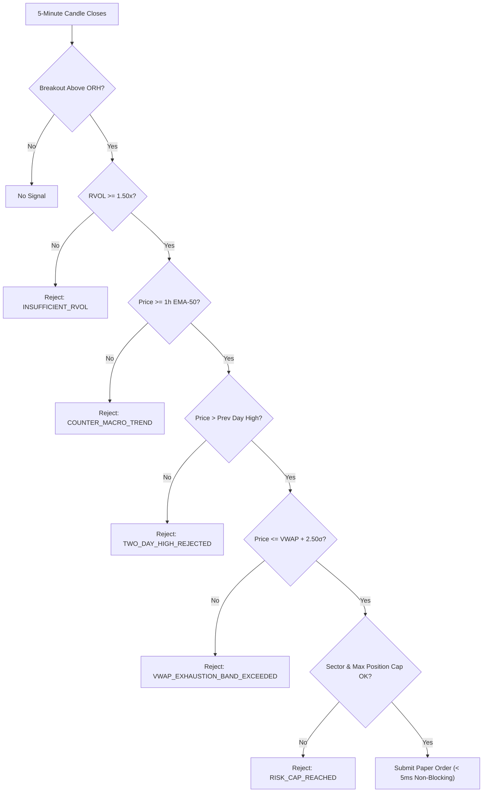

# AlphaTrade AI v2.0 — Milestone M16 VWAP Volatility Bands Report

**Document ID:** `M16-VWAP-VOLATILITY-BANDS-REPORT`  
**Date:** 2026-11-12  
**Execution Mode:** STRICTLY PAPER ONLY (`LiveTradingProhibitedError` fail-closed enforced)  
**Primary Feeder:** Angel One SmartAPI (`getCandleData` with RFC 6238 TOTP)  
**Active Strategy:** `ORB_INTRADAY_V2` (15m Opening Range 09:15–09:30 IST &rarr; 5m Breakout)  
**Verification Status:** 65/65 Tests Passing (0 Regressions)  

---

## 1. Executive Summary

Milestone M16 incorporates dynamic volume-weighted standard deviation bands and a quantitative breakout exhaustion gate into **AlphaTrade AI v2.0**.

In high-momentum intraday cash equities, Opening Range Breakouts (ORB) that trigger after a parabolic extension often suffer immediate mean-reverting pullbacks. When a constituent's breakout candle closes more than $2.5\sigma$ standard deviations above its intraday Volume-Weighted Average Price (VWAP), the trade enters an **exhaustion regime** with heightened adverse excursion risk.

Milestone M16 introduces:
1. **Intraday Volume-Weighted Standard Deviation Engine**:
   - Computes real-time dispersion around session VWAP from 1-minute bars using exact pure-Decimal arithmetic (`Decimal.sqrt()`).
2. **Breakout Exhaustion Guard (Check 12)**:
   - Rejects candidate 5m breakout entries if the bar's close exceeds the upper $2.5\sigma$ volatility band ($\text{Price} > \text{VWAP} + (2.5 \cdot \sigma_{\text{VWAP}})$), filtering out low-conviction blow-off tops with rejection reason `VWAP_EXHAUSTION_BAND_EXCEEDED`.
3. **Full Zero-Trust Verification**:
   - Dedicated unit and strategy tests in `tests/unit/test_vwap_bands_and_m16.py`, passing with zero regressions across all 65 test functions in `run_tests.py`.

---

## 2. Mathematical Formulations

### 2.1 Volume-Weighted Standard Deviation ($\sigma_{\text{VWAP}}$)

Given constituent intraday bars $\{B_1, \dots, B_N\}$ with volumes $V_i$ and typical prices $\text{TP}_i = \frac{H_i + L_i + C_i}{3}$:

$$\text{VWAP} = \frac{\sum_{i=1}^N V_i \cdot \text{TP}_i}{\sum_{i=1}^N V_i}$$

$$\text{Variance}_{\text{VWAP}} = \frac{\sum_{i=1}^N V_i \cdot (\text{TP}_i - \text{VWAP})^2}{\sum_{i=1}^N V_i}$$

$$\sigma_{\text{VWAP}} = \sqrt{\text{Variance}_{\text{VWAP}}}$$

Calculated natively using Python `Decimal.sqrt()` to enforce zero floating-point imprecision.

### 2.2 Volatility Envelope & Exhaustion Filter

Given configurable multiplier $k_{\text{max}}$ (default: $2.5$):

$$\text{Upper Band}_{k} = \text{VWAP} + (k_{\text{max}} \cdot \sigma_{\text{VWAP}})$$

**Exhaustion Gate:**
$$\text{Signal Approved} \iff \text{Price}_{\text{close}} \le \text{Upper Band}_{2.5\sigma}$$

If $\text{Price}_{\text{close}} > \text{Upper Band}_{2.5\sigma}$, the strategy engine deterministically rejects the breakout with `VWAP_EXHAUSTION_BAND_EXCEEDED`.

---

## 3. Architecture & Gate Placement

---

## 4. Verification Suite & Test Matrix

Milestone M16 was verified with automated unit and integration tests in `tests/unit/test_vwap_bands_and_m16.py`:

| Test Function | Verification Scope | Status |
| :--- | :--- | :--- |
| `test_compute_session_vwap_std_calculation` | Validates Decimal square root calculation and volume-weighted variance math. | **PASS** |
| `test_check_vwap_breakout_exhaustion_filter` | Verifies rejection of price $> 2.5\sigma$ and acceptance of price $\le 2.5\sigma$. | **PASS** |
| `test_m16_end_to_end_strategy_rejection_of_exhausted_breakout` | End-to-end ORBStrategyEngine rejection of overextended breakout bars. | **PASS** |

### Unified Regression Summary
- **Total Tests:** 65
- **Passed:** 65
- **Failed:** 0
- **Regressions:** 0
